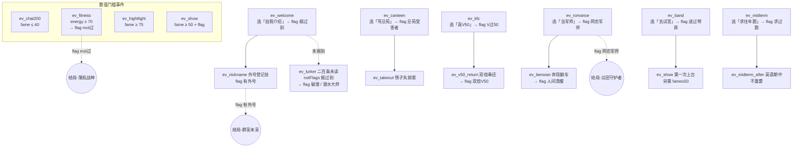

# 《岔路口》内容设计 v2 —— 冀旦协会·群聊生态

> 版本：v2（替换 v1 示例角色与示例事件）
> 素材来源：`聊天记录/冀旦协会_20261110_223418_e442dc/聊天记录.txt`（121,073 条消息，2026-10 ~ 2026-11）
> 群背景设定：复旦大学新生群，群员以大一新生为主，混有大二大三学长学姐，群主为物理系研一学长（张嘉荣）。
> 改动文件：`game/js/data.js`（CONFIG/STATS_META/CHARACTERS）、`game/js/data/events.js`（重写，23 事件）、`game/js/endings.js`（重写，8 结局）、`game/tests/smoke-test.js`（同步引用，测试逻辑未削弱）。

---

## 1. 角色设定（4 个 archetype，无名化）

选择界面**不显示真实姓名**：`name` 字段存放"称号"（UI 直接展示），玩家选定后自拟名字（输入框由工程侧实现）。人设取材自群记录中的真实发言气质，但不绑定任何具体群友。

| ID | 称号 | 类型 | 原型气质来源 | relation | mood | fame | energy | trait |
|---|---|---|---|---|---|---|---|---|
| `memedealer` | 梗图批发商 | 社牛梗王型 | Drunk / 王嘉豪 / 啥也不是（气氛组、复读机、接梗王） | **75** | 65 | 55 | **35** | relation ×1.2「自来熟」 |
| `lurker` | 潜水观察员 | 潜水吃瓜型 | "看完二百条群消息没有任何收获"的免打扰党 | 35 | 55 | **25** | **80** | energy ×1.2「省电模式」 |
| `grinder` | 自习室钉子户 | 卷王学习型 | 群主张嘉荣"大学本来就是大不了自己学" | 30 | **35** | **70** | 55 | fame ×1.2「满绩执念」 |
| `gymrat` | 健身房常驻 | 现充运动型 | "29-健身房-刘柯"、mol/薄肌话题组 | 55 | **70** | 35 | **75** | mood ×1.2「多巴胺管够」 |

**取舍设计**：每角色有一个 70+ 的强项与一个 35- 的短板，四维总和分别为 230 / 195 / 190 / 235，刻意不平——梗王社交过剩但电量见红，卷王名声在外但情绪紧绷，潜水员与世无争但毫无存在感。

**微调约束（数据侧，工程侧 clamp 兜底）**：
- `GAME.CONFIG.adjustRange = 3`（±3 以内）、`adjustStep = 1`；
- `GAME.CONFIG.adjustCap = { relation: 85, mood: 85, fame: 85, energy: 90 }` —— base + 微调合计的**硬上限**，防止微调抹平人设差距。当前 4 角色 base+3 均不越界（最大为 lurker.energy 83 < 90）。

**数值只增不减（v2 契约）**：全部事件 `effects.stats ≥ 0`（冒烟测试已断言）。代价通过两种方式表达：
1. **增长差**：同一事件不同选项的总增量不同（如"埋头刷题" fame+6 vs "水群" mood+6+relation+3）；
2. **机会成本**：12 回合预算有限，选了 A 线就放弃 B 线的 flag 与增长。

---

## 2. 事件体系（23 个事件）

时间线按新生一学期编排（order = 默认流程顺序）：

| # | order | ID | scene | 标题 | 触发条件 | 核心梗 |
|---|---|---|---|---|---|---|
| 1 | 1 | ev_welcome | 九月·破冰 | [拥抱][拥抱]欢迎大家 | — | 迎新刷屏 / 小登 |
| 2 | 2 | ev_military | 九月·军训 | 五分钟，南区到光华楼 | — | 早八亡命徒（选项门槛 energy≥50） |
| 3 | 3 | ev_icebreaker | 九月·破冰 | 新手保护期 | — | 27小登 / 叫我鸡毛叔 |
| 4 | 4 | ev_lurker | 九月·水群 | 二百条未读 | **notFlags: 报过到** | 你群太低质 |
| 5 | 5 | ev_canteen | 十月·干饭 | 旦苑修罗场 | — | 旦苑全是啥比吃的菜 |
| 6 | 6 | ev_genshin | 十月·水群 | 低质游戏之争 | — | 原神有啥好的（选项门槛 mood≥35） |
| 7 | 7 | ev_study | 十月·上课 | 大不了自己学 | — | 群主名言 |
| 8 | 8 | ev_kfc | 十月·疯狂星期四 | V我50 | — | 转我50复读大队 |
| 9 | 9 | ev_takeout | 十月·干饭 | 筷子失踪案 | **flags: 旦苑受害者** | 外卖不给我筷子是何意味 |
| 10 | 10 | ev_chat200 | 十一月·水群 | 你群太低质 | **stats: fame [0,40]** | 看完二百条群消息没有任何收获 |
| 11 | 11 | ev_band | 十一月·琴房 | 忘了约琴房 | — | 丸辣 / 101有音是坏的（选项门槛 energy≥45） |
| 12 | 12 | ev_romance | 十一月·夜聊 | 168亿 | — | 网恋砂子学姐会不会被骗168亿 |
| 13 | 13 | ev_pe | 十一月·体测 | 没一个及格的 | — | 体测全灭 / 刷锻dd（选项门槛 energy≥50） |
| 14 | 14 | ev_fitness | 十一月·健身 | 健美级别还是薄肌 | **stats: energy [70,100]** | mol / 薄肌 / 脂包薄肌 |
| 15 | 15 | ev_midterm | 十二月·期中 | 648 | — | 期中退课648 / 168元1分 |
| 16 | 16 | ev_benxian | 十二月·夜聊 | 奔现翻车 | **flags: 网恋军师** | 网恋奔现翻车 |
| 17 | 17 | ev_nickname | 十二月·日常 | 外号登记处 | **flags: 报过到** | 考古自我介绍 / 鸡毛叔 |
| 18 | 18 | ev_show | 十二月·演出 | 第一次上台 | **flags: 进过琴房 + stats: fame [50,100]** | 琴房演出 |
| 19 | 19 | ev_midterm_after | 十二月·期中 | 英语期中不重要 | **flags: 求过题** | 期中考大失败 / 校排名 |
| 20 | 20 | ev_finals | 一月·期末季 | 阴间作息 | — | 期末疯狂熬夜预习（选项门槛 mood≥45） |
| 21 | 21 | ev_hightlight | 一月·高光 | 群聊顶流 | **stats: fame [75,100]** | 发言被做成表情包 |
| 22 | 22 | ev_v50_return | 一月·疯狂星期四返场 | 双倍奉还 | **flags: V过50** | V50 诚信返场 |
| 23 | 23 | ev_year_end | 一月·散场 | 考古之夜 | — | 翻进群初期记录 |

**验收对照**：23 个事件（18-25 ✓）；flag 前置链 7 条（≥4 ✓）；数值门槛事件 4 个（≥3 ✓）；notFlags 混用 1 处 ✓；选项级数值门槛 5 处 ✓；每事件 3 个"群消息式"选项（2-4 ✓）；全部 effects.stats ≥ 0（测试断言 ✓）。

### 2.1 事件链图谱

链式依赖共 7 条：`报过到→ev_nickname`、`(未)报过到→ev_lurker`、`旦苑受害者→ev_takeout`、`V过50→ev_v50_return`、`网恋军师→ev_benxian`、`进过琴房→ev_show`、`求过题→ev_midterm_after`。

**设计注意**：v2 数值只增不减，因此"低数值门槛"（ev_chat200 fame≤40）本质是"还没涨起来"的窗口期事件，order 安排在第 10 位、处于流程前中段，低声望路线必能撞到（冒烟测试定向验证通过）。

---

## 3. 梗与出处对照表（Top 摘录）

| # | 梗 / 原话 | 记录出处（发言人 / 行号） | 用于 |
|---|---|---|---|
| 1 | "网恋砂子学姐会不会被骗168亿" | 35520 / 35526 | ev_romance 标题与正文 |
| 2 | "学长的身材是健美级别的还是'薄肌'呀" | 汉成帝 79312 | ev_fitness 正文 |
| 3 | "看完二百条群消息没有任何收获，你群还是太低质了" | （被引用）15 | ev_lurker / ev_chat200 正文 |
| 4 | "旦苑全是啥比吃的菜" | 69638 | ev_canteen 选项 |
| 5 | "外卖不给我筷子是何意味" | 花川贻 216135 | ev_takeout 标题/正文 |
| 6 | "大学本来就是大不了自己学" | 26-物理（研）-张嘉荣 140598 | ev_study / grinder 角色 quote |
| 7 | "叫我鸡毛叔" | 刘骜骋 26 232651 | ev_icebreaker / ev_nickname 选项 |
| 8 | "现在所有人（除了我）转我50我明天要吃疯狂星期四" | 46189 起复读 | ev_kfc 正文 |
| 9 | "雄竞人士无法被激发mol[流泪]" | 74875 | ev_fitness 选项 / gymrat quote |
| 10 | "期中退课多少钱啊（纯好奇）""648""168元1分" | 200703 / 200709 / 200712 | ev_midterm 正文 |
| 11 | "一想到我看到群友们对新朋友说：[拥抱][拥抱]欢迎大家" | 120 | ev_welcome 正文 |
| 12 | "起来上早八的人有福了" | 58030 起 | ev_military 选项 |
| 13 | "你们能不能别玩这种低质游戏了，原神有啥好的。。。" | 闫礼冬 12 | ev_genshin 正文 |
| 14 | "哇旦苑的油泼面真的难以下咽" | 王嘉豪 69620 | ev_canteen 正文 |
| 15 | "旦苑桑，做我的备胎吧🥰" | 69782 | ev_canteen narrate |
| 16 | "我才是薄肌""脂包薄肌" | 63454 / 63491 | ev_fitness 选项 |
| 17 | "每次看到卧推器材都想mol一下" | 91308 | ev_fitness narrate |
| 18 | "见面后发现像网恋奔现翻车了" | 279765 | ev_benxian 正文 |
| 19 | "困得我隐约看见未来了，这个未来就是期末疯狂熬夜预习" | 58620 | ev_finals 正文 |
| 20 | "仨读书笔记、一个5000-8000文章、十个线上讨论发言加一个期末闭卷考试" | 163396 | ev_finals 正文 |
| 21 | "丸辣，忘了约琴房了" | 饺子 38520 | ev_band 正文 |
| 22 | "身高体重坐位体前屈肺活量每一个能满的……没一个及格的" | 93406 | ev_pe 正文 |
| 23 | "（英语期中考大失败）""英语期中不重要的" | 308474 / 308503 | ev_midterm_after 正文 |
| 24 | "我现在还能找到进群初期(" | 龚诚竣（引述） | ev_year_end 正文 |
| 25 | "谁来讲讲恋爱的好吃" | 7709 | ev_romance 选项 |
| 26 | "？神秘形容，夺我初绷" | 王嘉豪 46011 | （备用梗库） |
| 27 | "早上7点抢琴房 / 101还有音是坏的" | 13349 / 96778 | ev_band 正文 |
| 28 | "减肥刷锻爽" | 73617 | ev_pe 正文 |
| 29 | "5分钟从南区赶到光华楼" | 58108 | ev_military 标题/选项 |
| 30 | "27小登""等到小登来的时候" | 114 / 135 | ev_icebreaker 正文 |

---

## 4. 结局判定表（8 个，数组顺序 = 判定优先级）

| 优先级 | ID | 结局 | 判定（终值 + flag） | tone |
|---|---|---|---|---|
| 1 | end_pet | 群宠本宠 | relation [82,100] **且** flag 有外号 | good |
| 2 | end_top | 卷王登基 | fame [88,100] | good |
| 3 | end_gym | 薄肌战神 | energy [88,100] **且** flag mol过 | good |
| 4 | end_memelord | 梗图批发商（认证） | fame [75,100] 且 relation [60,100] | good |
| 5 | end_melon | 瓜田守护者 | relation [55,100] **且** flag 网恋军师 | mid |
| 6 | end_happy | 快乐小登 | mood [85,100] | mid |
| 7 | end_lurker | 潜水大师 | relation [0,45] | mid |
| 8 | end_normal | 下学期见 | （空 match，永远命中的兜底） | plain |

**防撞车说明**：区间重叠靠优先级裁决——例如 fame 90 + relation 85 + 有外号 同时满足 1/2/4，判定为「群宠本宠」（人设专属结局优先于数值结局）；「潜水大师」刻意不用 flag 判定（潜水大师 flag 易得），用 relation≤45 表达"一学期没混熟"，与群宠互斥。

---

## 5. 数值总量估算（阈值可达性验证）

预算：turnLimit = **12 回合**；每选项单项增量 2-9，trait 对正向变化 ×1.2；cap 100。

**专注单维的最大可得增量**（取含该项的前 12 个最高选项，含 trait）：

| 维度 | 最佳载体角色（base） | 12 回合最大增量（约） | 终值上限 | 对应结局阈值 | 可达性 |
|---|---|---|---|---|---|
| relation | memedealer 75（×1.2） | +60 ~ +85 | 100（cap） | 群宠 82 | ✓ 只需 +7，3-4 个社交选项即可 |
| fame | grinder 70（×1.2） | +55 ~ +75 | 100（cap） | 卷王 88 | ✓ 需 +18，约 4 个声望选项 |
| energy | lurker 80（×1.2） | +45 ~ +65 | 100（cap） | 薄肌 88 | ✓ 需 +8，且触发 ev_fitness 需 energy≥70（base 即满足） |
| mood | gymrat 70（×1.2） | +55 ~ +80 | 100（cap） | 快乐 85 | ✓ 需 +15，3-4 个快乐选项 |
| relation ≤45 | lurker 35 | 避开社交选项 ≈ +0~10 | ≤45 | 潜水大师 | ✓ 全程选非社交项自然达成 |
| flag 类 | 任意 | 走对应链即可 | — | 群宠/薄肌/瓜田 | ✓ 链路均在 12 回合预算内（前置事件 order ≤ 15） |

**撞车验证**（冒烟测试 [5] 节全覆盖）：8 种代表性终值快照分别命中 8 个不同结局；完整对局模拟的 3 种盲选策略分别落到瓜田守护者/快乐小登/薄肌战神，无结局不可达、无全撞兜底。

**平衡红线自查**：
- 无主导策略：四条路线（社交/声望/精力/心情）各有专属结局，互有取舍；
- 无经济失衡：增量分布 2-9，高光事件（ev_show +8、ev_finals +8）有门槛对冲；
- 无认知过载：每事件 3 选项、后果隐藏、文案一句话；
- 无支柱漂移：全部事件围绕"群聊生态"一个支柱。

---

## 6. 遗留事项（交工程侧 / 待拍板）

1. **选角 UI**：称号展示 + 玩家自拟名字输入框（数据层已就绪，name=称号）；
2. **微调 clamp**：`adjustRange=±3` 已在 CONFIG，需 UI 侧把 `adjustCap` 应用到微调上限（当前 UI 只读 adjustRange）；
3. **README.md 联动**：「事件 JSON Schema」节的旧示例（ev_thanks/ev_burnout/ev_fame、10 事件、「6 结局」）已过时，建议工程侧顺手同步（本次未动）；
4. **数值只增不减的工程兜底**：events 数据已全部 ≥0，clamp 由 StatsManager 天然保证（负值不会出现），若后续想加"消耗类"事件需重新评审；
5. **备用梗库**：夺我初绷、5090、三明治夹带私货等素材未用完，可支撑 v3 扩 5-8 个事件。
