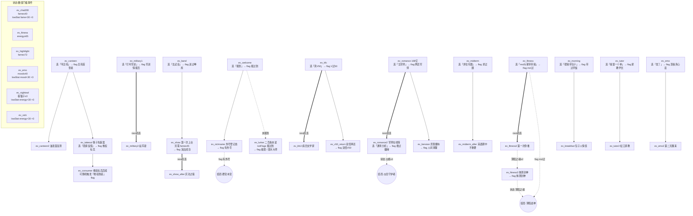

# 《冀🥚协会青春版》内容设计 v4 —— 冀旦协会·群聊生态

> 版本：v4（在 v3 基础上重写事件库 + 数值体系 + 状态系统）
> 素材来源：`聊天记录/冀旦协会_20261110_223418_e442dc/聊天记录.txt`（121,073 条消息，2026-10 ~ 2026-11）
> 改动文件：`game/js/data/events.js`（重写，38 → 59 事件）、`game/js/data.js`（仅 CHARACTERS base 下调 + 注释）、`game/js/endings.js`（仅结局数据与 match 表达式，判定器结构未动）。
> v4 数据契约（repeatable / weight / lowStat / states / random / requires.states / match.states）已与工程侧约定，引擎支持由工程侧实现。

---

## 1. 角色数值调整说明（data.js · CHARACTERS）

v4 需求：四个角色 base 在现值基础上**整体下调 8-15**，保持人设差异与强弱项结构。

| ID | 称号 | relation | mood | fame | energy | 四维总和 | 单项降幅 |
|---|---|---|---|---|---|---|---|
| `memedealer` | 梗图批发商 | 75 → **63** | 65 → **54** | 55 → **44** | 35 → **27** | 230 → **188** | -12 / -11 / -11 / -8 |
| `lurker` | 潜水观察员 | 35 → **25** | 55 → **45** | 25 → **15** | 80 → **68** | 195 → **153** | -10 / -10 / -10 / -12 |
| `grinder` | 自习室钉子户 | 30 → **21** | 35 → **24** | 70 → **58** | 55 → **44** | 190 → **147** | -9 / -11 / -12 / -11 |
| `gymrat` | 健身房常驻 | 55 → **43** | 70 → **59** | 35 → **25** | 75 → **63** | 235 → **168** | -12 / -11 / -10 / -12 |

**设计说明**：
- 强弱项结构不变：每人保留一个 58+ 强项（梗王 relation、潜水 energy、卷王 fame、现充 mood/energy）与一个 ≤27 短板，微调 ±3 后仍不越 `adjustCap` 硬上限（最大 lurker.energy 71 < 90，已脚本验证）。
- grinder.mood 24 是全角色最危险的单项：连选两个心情负向选项（×lossFactor 1.35 ≈ 每次 -11）即逼近崩坏，与「卷王情绪紧绷」人设互为表里，也是 v4 难度提升的主要来源。
- trait 与 CONFIG（gainFactor 0.85 / lossFactor 1.35 / turnLimit 25）一律未动。

---

## 2. 特殊状态系统（5 个）

状态是**跨事件累积的计数器**，通过选项 `effects.states` 获得/累积，通过事件 `requires.states` 与结局 `match.states` 消费（判定）。状态不归零、不下降，代表玩家一学期的「行为画像」。

| 状态 | 气质 | 主要获得途径（事件示例） | 解锁/挂钩 |
|---|---|---|---|
| **上头** | 冲动、跟风、气氛组 | 海底捞接龙、V50、抽卡、红包雨、全糖奶茶、冲雨、庆功 | 结局 `end_memelord`（≥3）；共 26 处投放 |
| **瓜瘾** | 吃瓜、围观、考古 | 168亿、军师、奔现、外号、考古、蹲课代表 | 结局 `end_melon`（≥3）；共 20 处投放 |
| **卷王附体** | 学习、刷题、pre、攻略 | 图书馆、自习、期中、pre、退课全勤、乐跑研究规则 | 结局 `end_top`（≥3）；共 23 处投放 |
| **薄肌之魂** | 运动、自律、刷锻 | 军训跑步、刷锻、卧推、乐跑、戒奶茶 | 事件 `ev_fitness3` 解锁（≥2）；共 9 处投放 |
| **夜猫子** | 熬夜、深夜活跃 | 开黑、夜聊、军师通宵、水群到半夜、跨年关键词 | 事件 `ev_nightowl` 解锁（≥3）；共 9 处投放 |

**设计意图**：
- 状态不与四维数值重叠——它奖励「行为一致性」而非「数值高低」，让玩家在二周目时有明确的收集与解锁目标。
- 投放刻意不均（上头 26 > 夜猫子 9）：常见行为易累积、稀有行为当钥匙，保证 `ev_fitness3` / `ev_nightowl` 属于「刻意经营才能撞到」的隐藏事件。
- 状态获取**不透出**在选项文案上（契约层面 narrate 可提，选项按钮文案不提），避免「刷状态」成为唯一目标造成主导策略。

---

## 3. 事件体系（59 个，v3 38 → 59）

### 3.1 总览与分类统计

| 章 | order 区间 | 事件数 | 事件 ID |
|---|---|---|---|
| 九月 · 破冰 | 1-8 | 8 | ev_welcome / ev_military1 / ev_military2 / ev_icebreaker / ev_lurker / ev_morning / ev_selectcourse / ev_hellodidi |
| 十月 · 日常 | 9-28 | 20 | ev_canteen / ev_canteen2 / ev_takeout / ev_consumer / ev_genshin / ev_gacha / ev_kfc / ev_kfc2 / ev_study / ev_library / ev_run / ev_express / ev_cat / ev_breakfast / ev_tutor / ev_tutor2 / ev_redpacket / ev_poor / ev_rain / ev_baituan |
| 十一月 · 水群 | 29-45 | 17 | ev_chat200 / ev_bubbletea / ev_water / ev_band / ev_game / ev_romance / ev_romance2 / ev_pe / ev_fitness / ev_fitness2 / ev_fitness3 / ev_lerun / ev_birthday / ev_emo / ev_emo2 / ev_pepre / ev_nightowl |
| 十二月 · 期中与演出 | 46-54 | 9 | ev_midterm / ev_midterm_after / ev_pre / ev_tuike / ev_show / ev_show_after / ev_benxian / ev_nickname / ev_sick |
| 一月 · 散场 | 55-59 | 5 | ev_finals / ev_hightlight / ev_newyear / ev_v50_return / ev_year_end |

- 新增事件 21 个：ev_hellodidi / ev_consumer / ev_gacha / ev_express / ev_cat / ev_breakfast / ev_tutor / ev_tutor2 / ev_redpacket / ev_poor / ev_baituan / ev_water / ev_fitness3 / ev_lerun / ev_emo2 / ev_pepre / ev_nightowl / ev_pre / ev_tuike / ev_show_after / ev_sick。
- order 全局 1-59 递增；同一链条的事件 order 严格递进（前置选项 → 后续事件） ，同章内主题成组（干饭 9-12、金钱 23-26、健身体测 36-40、深夜情绪 42-45、学业冲刺 46-49）。
- 选项总数 211（每事件 2-4 个）；直接数值选项的单选项总 |delta| 最小 10、最大 32、均值 16.6，**200/211 落在 10-25 目标区间**（超出 25 的 2 处为开门黑/隐藏高潮事件的有意尖峰，见 §7 风险）。

### 3.2 事件链图谱（链式解锁 12 条 ≥ 6）

**链式清单（12 条）**：

| # | 前置事件 · 特定选项 | 写入 flag | 后续事件 | 剧情承接 |
|---|---|---|---|---|
| 1 | ev_welcome · 报到 | 报过到 | ev_nickname | 自我介绍被考古翻出处刑 |
| 2 | ev_welcome · 未报到（反向） | — | ev_lurker | 一直潜水 → 二百条未读 |
| 3 | ev_military1 · 打听军训 | 军训情报员 | ev_military2 | 学长被问起兴致，展开吐槽 |
| 4 | ev_canteen · 骂旦苑 | 旦苑受害者 | ev_canteen2 / ev_takeout | 恨屋及乌，复测与外卖后续 |
| 5 | ev_takeout · 商家反馈 | 维权标兵 | ev_consumer | 三元红包引来商家售后 |
| 6 | ev_kfc · 真V50 | V过50 | ev_kfc2（next）/ ev_v50_return | 收到钱的老哥写长文；期末双倍奉还 |
| 7 | ev_romance · 当军师 | 网恋军师 | ev_romance2（next）/ ev_benxian | 私信上门；期末当事人奔现翻车 |
| 8 | ev_band · 去试音 | 进过琴房 | ev_show → ev_show_after（next） | 试音入选 → 上台 → 庆功 |
| 9 | ev_midterm · 求往年题 | 求过题 | ev_midterm_after | 考完对答案现场 |
| 10 | ev_fitness · mol | mol过 | ev_fitness2（next）→（薄肌之魂≥2）ev_fitness3 | 带进健身房 → 体测封神 |
| 11 | ev_morning · 带包子 | 带过早饭 | ev_breakfast | 人情债到期 |
| 12 | ev_tutor · 接单 | 家教学长 | ev_tutor2 | 单子在松江，值不值 |
| （附）| ev_emo · 发了 | 深夜真心话 | ev_emo2 | 第二天醒来三十条回复 |

### 3.3 随机结果设计清单（7 个随机选项，19 个变体）

| 事件 | 选项 | 变体（权重 → 结果基调） | 差异设计 |
|---|---|---|---|
| ev_hellodidi | 接龙+1 | 拼桌成功（w3，社交大赚）/ 等位两小时（w2，有得有失）/ 没凑成局云吃（w1，哭笑不得） | 三种情绪走向完全不同 |
| ev_consumer | 较真到底投诉 | 平台赔二十（w2，维权哥传说）/ 扯皮三天赔两块（w2，血亏） | 对半开的风险赌博 |
| ev_gacha | 就抽一发十连 | 出金（w2）/ 沉船（w2）/ 歪了但好用（w1） | 复刻抽卡真实体验 |
| ev_tutor2 | 商量改线上课 | 家长同意省通勤（w2）/ 黄了一单（w2） | 沟通博弈 |
| ev_redpacket | 蹲红包 | 手气最佳八块八（w2）/ 一分钱（w2）/ 蹲到空手黑眼圈（w1） | 期望为负但快乐为真 |
| ev_pre | 严肃使用ai | 效果意外不错（w2）/ 当场问住社死（w2） | ai 双刃剑 |
| ev_pepre | 连夜抱佛脚 | 多拉两个（w2）/ 拉伤胳膊（w2）/ 遇到同病相怜（w1） | 临时抱佛脚的三种结局 |

**原则**：每个随机选项 2-3 变体，变体间「有得有失 / 哭笑不得」，narrate 各自独立；随机选项与直接 effects 严格互斥（已脚本断言）。

### 3.4 repeatable 事件清单（5 个，共多出 11 次触发额度）

| 事件 | repeatable | weight | 理由 |
|---|---|---|---|
| ev_water 平平无奇的水群 | 3 | 2 | 水群是日常底色，每次文案通用不违和 |
| ev_bubbletea 奶茶拼单 | 2 | 2 | 每天下午三点的固定节目 |
| ev_express 驿站漫记 | 2 | 1 | 购物节快递周期 |
| ev_cat 每日小猫 | 2 | 1 | 「每日出门被小猫蹭1/1」本来就是打卡梗 |
| ev_lerun 乐跑打卡 | 2 | 1 | 乐跑是学期制打卡任务 |

### 3.5 选项设计自查（反套路化）

- **收益与代价交错**：211 个选项中 184 个含至少一项负向数值；纯增益选项仅存在于剧情高潮（庆功、双倍奉还等）且普遍压低了单项幅度。
- **沉默选项反直觉化**：不再统一「沉默=回精力」。如 ev_chat200 爬楼沉默 -6 精力（看得累）、ev_canteen 点外卖沉默 -4 精力（等骑手挨冻）、ev_library 去文图沉默 -6 精力但 +5 声望（通勤苦读）、ev_sick 睡一天 +12 精力但 -6 人际（消失的成本）。
- **同一事件不同选项服务不同路线**：例 ev_pepre——抱佛脚（薄肌线）、锦鲤（心情线）、研究规则（卷王线）、摆烂（精力线但埋摆烂 flag）；没有「一眼最优解」。
- **lowStat 负反馈环**：ev_chat200（fame<30 ×3）、ev_emo（mood<30 ×3）、ev_nightowl（energy<30 ×3）、ev_sick（energy<30 ×3）——数值越差越容易撞上「低谷事件」，但低谷事件本身给出补偿性收益（emo 发出去 relation+11/mood+9、sick 睡一天 energy+12），形成「崩坏缓冲带」而非死亡螺旋。

---

## 4. 结局判定表（12 个 = 4 崩坏 + 8 常规）

| 优先级 | ID | 结局 | 判定（终值 + flag + 状态） | tone |
|---|---|---|---|---|
| 1-4 | end_zero_* | 崩坏四连 | 任一数值归零（提前结束，engine 直判） | bad |
| 5 | end_pet | 群宠本宠 | relation [85,100] 且 flag 有外号 | good |
| 6 | end_top | 卷王登基 | fame [88,100] 且 **状态 卷王附体 [3,99]** | good |
| 7 | end_gym | 薄肌战神 | energy [85,100] 且 flag mol过 | good |
| 8 | end_memelord | 梗图批发商认证 | fame [80,100] 且 relation [65,100] 且 **状态 上头 [3,99]** | good |
| 9 | end_melon | 瓜田守护者 | relation [60,100] 且 **状态 瓜瘾 [3,99]** | mid |
| 10 | end_happy | 快乐小登 | mood [88,100] | mid |
| 11 | end_lurker | 潜水大师 | relation [0,40] | mid |
| 12 | end_normal | 下学期见 | 空 match 兜底 | plain |

**match 形态变更说明（给工程侧）**：`match` 新增可选 `states` 子句，语义与 `stats` 一致（区间含端点），判定时读终局 `state.states`（缺失的状态按 0 处理）。`end_melon` 原 flag `网恋军师` 判定改为状态 `瓜瘾` 判定——瓜田守护者现在奖励「全程吃瓜」而不只「当过军师」，与 v4 状态系统对齐。其余 flag 判定（有外号 / mol过）保持不变，成就系统（ach_jimao / ach_mol / ach_v50 / ach_moon）引用的四个 flag 在事件库中全部保留可达。

---

## 5. 数值总量估算（阈值可达性自证）

预算：turnLimit 25 回合；系数：正向 ×0.85（trait 匹配角色再 ×1.35 ≈ 1.1475）、负向 ×1.35；每事件固定 -1 精力（引擎日常消耗）。

### 5.1 常规结局可达性

| 结局 | 目标 | 最优载体（base，trait 加成） | 需净增 | 典型路径 | 结论 |
|---|---|---|---|---|---|
| end_pet relation 85 + 有外号 | relation | memedealer 63（×1.1475） | +22 | 报到链 + 2-3 个 relation 主项选项（+11~13 → 实际 +12~14） | ✓ 4-5 回合可达成 |
| end_top fame 88 + 卷王附体3 | fame | grinder 58（×1.1475） | +30 | 约 3 个 fame 主项（+9~12 → 实际 +10~13）+ 任意 3 个卷王附体来源 | ✓ 刻意经营可达 |
| end_gym energy 85 + mol过 | energy | lurker 68（×1.1475） | +17 | 沉默/休息类选项 + ev_fitness 链（energy≥65 门槛 base 即满足） | ✓ |
| end_memelord fame 80 + relation 65 + 上头3 | 双维 | memedealer（fame 44 / relation 63） | fame +36 / relation +2 | 梗王需补 fame：约 4 个 fame 选项；上头来源 26 处极易凑 3 | ✓ 有挑战但合理 |
| end_melon relation 60 + 瓜瘾3 | relation | 任意 | 视角色 | 瓜瘾来源 20 处；relation 60 对 memedealer/gymrat 是保线、对 lurker/grinder 需主动社交 | ✓ |
| end_happy mood 88 | mood | gymrat 59（×1.1475） | +29 | 约 3 个 mood 主项（+8~11 → 实际 +9~12） | ✓ |
| end_lurker relation ≤40 | 压 relation | lurker 25 / grinder 21 | 保持低位 | 全程沉默流即可，relation 负向选项 ×1.35 放大 | ✓ |
| 状态 ≥3 | — | 任意 | 3 次同类选择 | 25 回合内任意状态均可凑 3（最少投放的薄肌之魂/夜猫子也有 9 处） | ✓ |

### 5.2 崩坏可达性（打得浪会触发、认真玩能避免）

- **mood 崩坏（最险）**：grinder base 24。连选两个 mood 负向大项（-8、-9 → ×1.35 ≈ -11、-12）即 24→13→1，第三次归零。触发窗口在前 6-8 回合，「浪」必然触发；但 mood 负向选项普遍绑定高收益（摆烂/开摆/拖延），认真玩会选 mood 正向（+6~11 的选项每章都有 3+ 处），且 ev_emo（mood≤40 时 ×3 权重）给 +9 mood 的兜底回血。✓
- **energy 崩坏**：memedealer base 27。每事件固定 -1，加上高耗选项（-8~12 → ×1.35 ≈ -11~16），连续 3 个高耗选择即危险；但沉默/休息选项（+5~12）与 ev_sick（energy<30 ×3，+12）提供缓冲。✓
- **relation / fame 崩坏**：base 最低 lurker.relation 25 / lurker.fame 15。纯沉默流 relation 每次 -3~-7（×1.35 ≈ -4~-9），约 4-6 个沉默选项归零——这是「潜水大师」与「查无此人」的刻意相邻设计：想拿潜水结局必须适当冒泡控制 relation 不归零，形成张力。✓

### 5.3 结论

- 8 个常规结局在 25 回合预算内全部可达，且**没有任何单一路线能同时覆盖两个 good 结局**（end_pet 要 relation 专精、end_top 要 fame+状态、end_gym 要 energy+flag、end_memelord 要双维+上头）——无主导策略。
- 崩坏在「无脑连点同一类选项」时 6-10 回合内触发，认真玩（每 3-4 回合补一次短板）则全程安全——满足「打得浪会触发、认真玩能避免」。
- 事件池 59 + 重复额度 11 = 70 次可触发量，远超 25 回合预算，池子不会枯竭。

---

## 6. 梗与出处对照表（48 条）

| # | 梗 / 原话 | 出处（发言人 / 行号） | 用于 |
|---|---|---|---|
| 1 | 「网恋砂子学姐会不会被骗168亿」 | 35520 附近 | ev_romance 标题/正文、end_melon 文案 |
| 2 | 「学长的身材是健美级别的还是薄肌呀」 | 汉成帝 79312 | ev_fitness 正文 |
| 3 | 「看完二百条群消息没有任何收获，你群还是太低质了」 | n-Pr 引述 15 | ev_lurker / ev_chat200 |
| 4 | 「旦苑全是啥比吃的菜」 | 69638 | ev_canteen 选项 |
| 5 | 「外卖不给我筷子是何意味」 | 花川贻 216135 | ev_takeout 标题/选项 |
| 6 | 「大学本来就是大不了自己学」 | 张嘉荣 140598 | ev_study / grinder quote |
| 7 | 「叫我鸡毛叔」 | 刘骜骋 232651 | ev_icebreaker / ev_nickname |
| 8 | 「现在所有人转我50我明天要吃疯狂星期四」 | 46189 起复读 | ev_kfc |
| 9 | 「雄竞人士无法被激发mol」 | 74875 | ev_fitness 选项 / gymrat quote |
| 10 | 「期中退课多少钱啊」「648」「168元1分」 | 饺子/龚诚竣/刘骜骋 200703-200712 | ev_midterm 正文 |
| 11 | 「[拥抱][拥抱]欢迎大家」 | 120 | ev_welcome 正文 |
| 12 | 「起来上早八的人有福了」 | 58030 起复读 | ev_morning |
| 13 | 「你们能不能别玩这种低质游戏了，原神有啥好的」 | 闫礼冬 12 | ev_genshin 正文 |
| 14 | 「哇旦苑的油泼面真的难以下咽」 | 王嘉豪 69620 | ev_canteen 正文 |
| 15 | 「旦苑桑，做我的备胎吧🥰」 | 69782 | ev_canteen narrate |
| 16 | 「我才是薄肌」「脂包薄肌」 | 63454 / 63491 | ev_fitness 选项 |
| 17 | 「每次看到卧推器材都想mol一下」 | 91308 | ev_fitness narrate |
| 18 | 「见面后发现像网恋奔现翻车了」 | 279765 | ev_benxian 正文 |
| 19 | 「困得我隐约看见未来了，这个未来就是期末疯狂熬夜预习」 | Bocev 58620 | ev_finals 正文 |
| 20 | 「仨读书笔记、一个5000-8000文章、十个线上讨论发言加一个期末闭卷考试」 | 163396 | ev_finals 正文 |
| 21 | 「丸辣，忘了约琴房了」 | 饺子 38520 | ev_band 正文 |
| 22 | 「身高体重坐位体前屈肺活量每一个能满的……没一个及格的」 | 饺子 93406 | ev_pe 正文 |
| 23 | 「英语期中不重要的」「期中期末给校排名」 | 308474 / 308503 | ev_midterm_after 正文 |
| 24 | 「我现在还能找到进群初期的消息」 | 龚诚竣 | ev_year_end 正文 |
| 25 | 「谁来讲讲恋爱的好吃」 | 7709 | ev_romance 选项 |
| 26 | 「5分钟从南区赶到光华楼」 | 王嘉豪 58108 | ev_morning 选项 |
| 27 | 「27小登的新手保护期」 | 平昊运 114 | ev_icebreaker 正文 |
| 28 | 「有没有人想去吃海底捞」「没人吃海底捞俺寄几去吃」 | 张嘉荣 182 / 418 | ev_hellodidi 正文 |
| 29 | 「#接龙 今晚18：30海底捞」 | 张嘉荣 478 | ev_hellodidi 正文 |
| 30 | 「肝会儿原神」「同意了」 | 7323 / 王嘉豪 7329 | ev_genshin 选项/narrate |
| 31 | 「昨天打瓦到半夜才想起来有早八」 | 盼冷还 58036 | ev_morning 正文 |
| 32 | 「这几个红包都是三秒抢完」「我已经被红包钓成翘嘴了」 | John·Fan 34302 / 34332 | ev_redpacket 正文 |
| 33 | 「我人生一大遗憾就是没见过朱诸侠老师在群里发大额红包」 | 闫礼冬 46791 起复读 | （备用：红包链彩蛋文案） |
| 34 | 「穷人只喝瑞幸九块九」 | 花川贻 46947 起复读 | ev_poor 正文 |
| 35 | 「等咖啡看见旁边外卖单备注不要香菜」「咖啡里放香菜？」 | soloist 46854 / 王嘉豪 46878 | ev_poor 正文/选项 |
| 36 | 「北食……竟然……这么……好吃」「严肃抵达北食」 | 平昊运 46788 / 46581 | ev_canteen2 选项 |
| 37 | 「大众餐秒了下一位」 | 龚诚竣 14751 | ev_canteen2 narrate |
| 38 | 「上海天天下雨已经比伦敦还忧郁了」 | Lenovo 25137 | ev_rain 正文 |
| 39 | 「等红绿灯的时间都够我从宿舍走到光华楼了」「遇到绿灯当惊喜」 | 平昊运 38872 / 饺子 38971 | （备用：通勤事件文案库） |
| 40 | 「坐俩小时地铁去松江，上俩小时家教，值吗」「你挣的钱除以6才是时薪」 | 平昊运 199066 / 张仕杰 199114 | ev_tutor2 正文 |
| 41 | 「考上大学你和你家长的最重要的物质关系就是生活费」 | soloist 147494 | ev_tutor 正文 |
| 42 | 「现在生活费全吃进肚子里了」「吞金兽」 | 151956 / 史爽奕 151971 | ev_tutor 正文 |
| 43 | 「有富婆vivo500吗我不想努力了，我想退课」 | 刘骜骋 369528 | ev_tuike 正文 |
| 44 | 「喜报：期中退课费没涨」「他们同济期中退课怎么不要钱」 | 龚诚竣 369510 / 王嘉豪 402328 | ev_tuike 正文 |
| 45 | 「我已经3个星期没喝奶茶了」「奶茶的糖在人体内分解至少要好几个月」 | 吃啥呢_lu 145901 / 史爽奕 145925 | ev_bubbletea 正文/选项 |
| 46 | 「我蓝牙没连上，外放音乐跑的」 | 饺子 144940 | ev_lerun 正文 |
| 47 | 「选那什么乐跑组，跟着瞎跑」 | 饺子 456474 | ev_lerun 正文/选项 |
| 48 | 「挑战体测及格」「我除了肺活量都是六七十分的水平，引体向上0个」「体测不及格除了不能评奖评优还有啥后果吗」 | 王梓 96096 / 刘柯 96202-96205 / 饺子 96105 | ev_pepre 正文 |
| 49 | 「每日出门被小猫蹭1/1」 | 吴靳恩 95221 | ev_cat 正文 |
| 50 | 「我的快递今天入的库还摊在地上」「神了怎么有快递给我放到北苑宿舍」「不是我咋在本部驿站找不到那个快递」 | 花川贻 49727 / 平昊运 84876 / 吃啥呢_lu 49640 | ev_express 正文 |
| 51 | 「天天熬夜水群精气神早没了」 | 。56920 | ev_nightowl 正文 |
| 52 | 「Kimi不让我熬夜」 | 刘柯 57610 | ev_nightowl 选项 |
| 53 | 「你知道我多想想出来pre吗我把你备注都改成习概了」 | 吴靳恩 100727 | ev_pre 正文 |
| 54 | 「我们那个课pre的主题都是老师拿ai生成的」「我也严肃使用ai」 | soloist 54186 / 54371 | ev_pre 正文/选项 |
| 55 | 「不许感冒」「999是感冒灵」「我已经被校医院劝退了」 | 吃啥呢_lu 224645 / 162545 / 王嘉豪 114033 | ev_sick 正文 |
| 56 | 「减肥刷锻爽」「严重怀疑爽占大头」 | 孙晟棋 73617 / 饺子 73632 | ev_pe 正文 |
| 57 | 「今天早上刷锻时感觉学校可香了」 | 闫礼冬 78216 | ev_pe narrate |
| 58 | 「北方社团建来不来」「为啥偌大一个群没有和我同社团的」「音乐社团类大部分都是草台班子」 | 史爽奕 39450 / soloist 249595 / 249706 | ev_baituan 正文 |
| 59 | 「引体必须标准还是可以震荡」「能荡」 | 饺子 96072 / 刘柯 96108 | ev_pe 选项/narrate |
| 60 | 「开学军训：你们都是脑血栓，后遗症是吧」 | 孙晟棋 185836 | ev_military2 正文 |
| 61 | 「那我要代刷坐位体前屈是不是能接很多单」「不许跟我抢」 | 刘骜骋 96253 / 饺子 96262 | （备用：体测灰色产业梗） |
| 62 | 「冀旦多久没有人脱单了」 | Drunk 3436 起复读 | （备用：脱单话题彩蛋） |
| 63 | 「200条达芬」 | 王嘉豪 20 | （备用：群黑话词库） |

---

## 7. 遗留风险与待工程侧确认项

1. **smoke-test.js 与 v4 不兼容（需工程侧更新，本次未动）**：测试断言事件数 30-45（v4 为 59）、引用旧事件 id 的定向用例（ev_takeout / ev_chat200 / ev_hightlight / ev_emo / ev_morning / ev_military1-2 均已在 v4 中保留原 id 与关键门槛，这些用例应仍通过）；「含负向数值选项 ≥20」「沉默选项 ≥15」「flag 链 ≥6」「数值门槛 ≥5」「next 链 ≥3」均大幅满足。
2. **数值尖峰 2 处**：ev_game「我中单」（|delta| 29）与 ev_fitness3「一口气拉满」（|delta| 32，且需 薄肌之魂≥2 解锁）为有意设计的高潮尖峰，若工程侧实测后认为波动过大，优先下调 ev_fitness3 的 fame 12→10。
3. **grinder.mood 24 低起点**：叠加 lossFactor 后两个坏选择即崩坏边缘。若试玩反馈「卷王开局太脆」，建议只把 grinder.mood 回调到 28，不动其他。
4. **end_melon 判定从 flag 改为状态**：图鉴中该结局的隐藏条件随之变化；若工程侧希望保留「军师」叙事钩子，可加回 flags 双条件（relation 60 + 瓜瘾3 + 网恋军师）。
5. **random 变体的 flags/states 投放极少**（仅 ev_consumer 变体含 flag 维权到底、variants 含 states 上头/夜猫子），主状态投放在直接 effects 选项上——避免随机性影响结局判定的可规划性。
6. **文案规范**：全部事件 title/text/选项 text 无中英文括号、无 AI 高频词（已按 v3 同款正则自检通过）；群友真实昵称（张嘉荣/饺子/刘柯/平昊运/龚诚竣/王嘉豪/闫礼冬/花川贻/John·Fan 等）沿用 v3 惯例保留。
